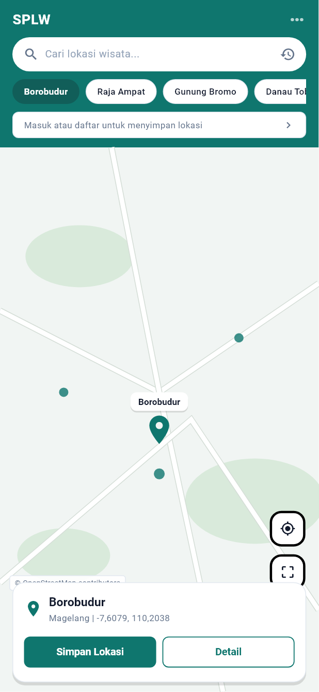
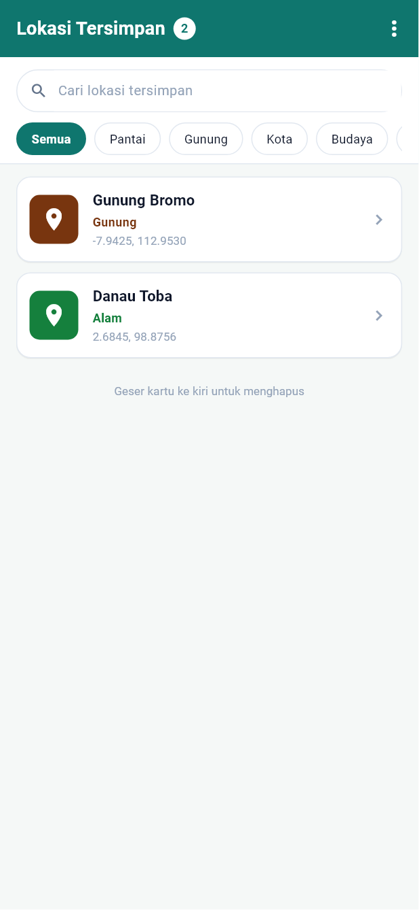
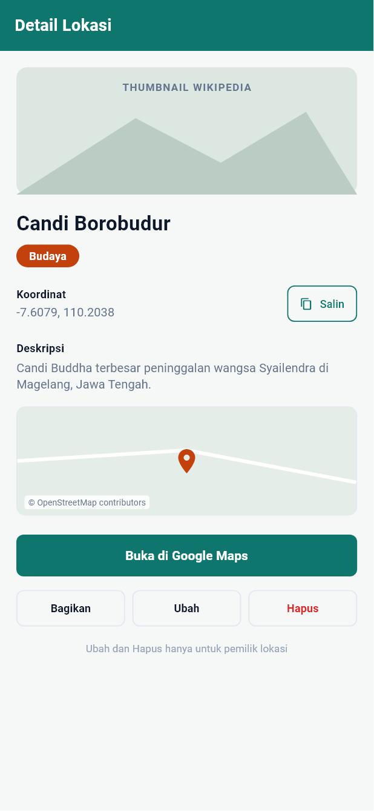
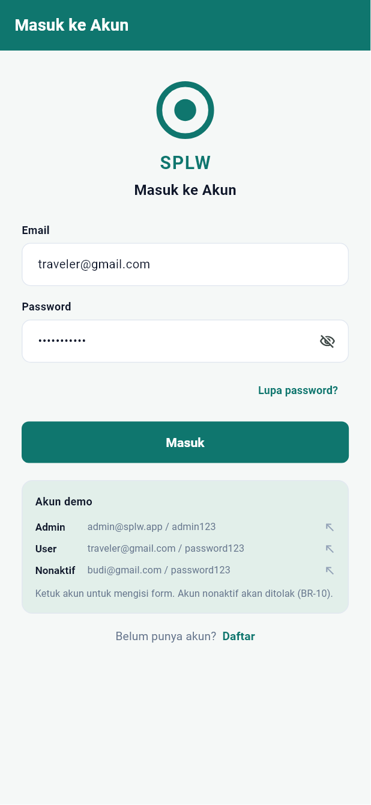
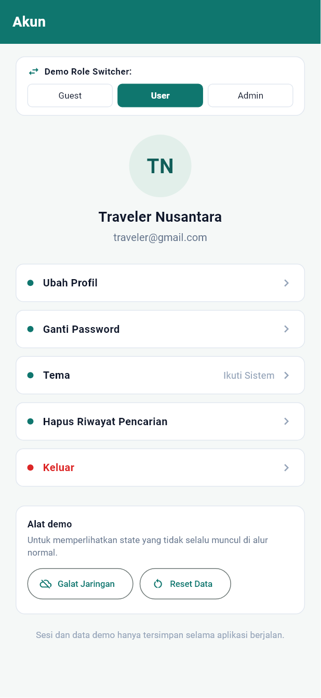
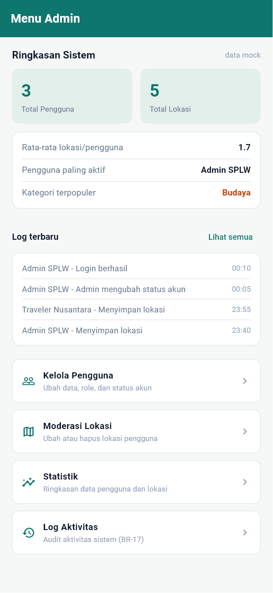

# SPLW Mobile - Prototype Flutter

Prototipe antarmuka interaktif untuk **Sistem Pencarian dan Penyimpanan Lokasi Wisata (SPLW) Berbasis Mobile**. Prototipe ini mendemokan alur utama BRD/PRD dengan **data mock in-memory**; belum terhubung ke backend, database, layanan peta, atau penyimpanan permanen.

- **Pengembang:** Zefhana Ananda (20240801047)
- **Mata Kuliah:** Pemrograman Mobile
- **Program Studi:** Teknik Informatika, Fakultas Ilmu Komputer, Universitas Esa Unggul
- **Stack:** Flutter, Dart, Material 3
- **Entry point:** `lib/project/prototype/main.dart`

## Status Prototipe

| Aspek | Status |
| :--- | :--- |
| UI interaktif | Tersedia |
| Autentikasi/role | Simulasi lokal |
| Data lokasi | Mock in-memory |
| Peta | Ilustrasi `CustomPaint`, bukan tile OSM live |
| Pencarian | Quick chip + riwayat lokal + fallback mock |
| Penyimpanan permanen | Belum ada; data kembali ke seed saat aplikasi dimuat ulang atau **Reset Data** |
| Backend/FastAPI | Belum ada |
| Ekspor `.xlsx` | Dialog simulasi; tidak membuat berkas nyata |

## Menjalankan

```bash
flutter pub get
flutter run -d chrome -t lib/project/prototype/main.dart
```

Di layar lebar, aplikasi dibungkus frame ponsel maksimal 430 px. Di layar ponsel/emulator, aplikasi memakai seluruh layar.

Android:

```bash
flutter run -d android -t lib/project/prototype/main.dart
```

## Akun Demo

| Peran | Email | Password | Catatan |
| :--- | :--- | :--- | :--- |
| Admin | `admin@splw.app` | `admin123` | Memiliki menu Admin dan 3 lokasi awal |
| User | `traveler@gmail.com` | `password123` | Memiliki 2 lokasi awal |
| Nonaktif | `budi@gmail.com` | `password123` | Login ditolak (BR-10) |

Kode OTP reset password demo: **`482917`**. Kode berlaku 15 menit dan terkunci setelah 5 percobaan salah (simulasi lokal).

## Layar yang Didemokan

| Layar | Isi |
| :--- | :--- |
| S-01 Splash | Splash singkat sebelum masuk ke shell utama |
| S-02 Peta | Pencarian, quick chip, riwayat pencarian, GPS mock, zoom mock, bottom result card, atribusi OSM dekoratif |
| S-03/S-04 Login & Registrasi | Validasi form, akun demo, penolakan akun nonaktif |
| S-05/S-06 Lupa & Reset Sandi | Bottom sheet OTP, password baru, pencabutan sesi lokal |
| S-07 Lokasi Tersimpan | Hanya data milik pengguna, pencarian, filter kategori, swipe-to-delete, ekspor simulasi |
| S-08 Form Simpan/Ubah | Nama, koordinat read-only, kategori, deskripsi, validasi dan cek duplikat |
| S-09 Detail Lokasi | Salin koordinat, mini map, tautan Google Maps (simulasi), share/revoke, edit/hapus |
| S-10 Akun | Edit profil, ganti password, tema, role switcher, reset data, demo galat jaringan |
| S-11 Riwayat Pencarian | Bottom sheet riwayat lokal, hapus satuan/semua, maksimal 6 entri |
| S-12 Admin Dashboard | Statistik pengguna/lokasi, pengguna teraktif, kategori terpopuler, log ringkas |
| S-13 Admin Pengguna | Cari, ubah data/role, aktif/nonaktif, hapus cascade dengan konfirmasi |
| S-14 Admin Lokasi | Cari/filter semua lokasi, ubah/hapus dengan konfirmasi |
| S-15 Admin Log Aktivitas | Filter log, detail log, IP mock, waktu, read-only |

## Matriks BR-01 s/d BR-17

Status di bawah menunjukkan **perilaku yang didemokan pada data mock**, bukan kesiapan produksi.

| ID | Perilaku yang didemokan | Status |
| :--- | :--- | :--- |
| BR-01 | Guest diarahkan login saat menyimpan lokasi | Didemokan |
| BR-02 | Hanya pemilik (atau admin) yang dapat mengubah/menghapus | Didemokan |
| BR-03 | Kategori wajib; default `Lainnya` | Didemokan |
| BR-04 | Admin dapat mengelola semua akun dan lokasi | Didemokan |
| BR-05 | Ekspor hanya untuk user login dan hanya data sendiri | Simulasi dialog; bukan `.xlsx` nyata |
| BR-06 | Ganti password memerlukan password lama, min. 8 karakter, konfirmasi | Didemokan secara lokal |
| BR-07 | OTP 6 digit, 15 menit, maksimal 5 percobaan | Mock; kode tetap `482917`, tanpa pengiriman email |
| BR-08 | Reset password mencabut sesi aktif | Mock; hanya state lokal |
| BR-09 | Koordinat duplikat milik pengguna yang sama ditolak (4 desimal) | Didemokan |
| BR-10 | Akun nonaktif ditolak saat login | Didemokan |
| BR-11 | Izin GPS opsional; fitur non-GPS tetap berjalan | Dialog izin mock; tanpa GPS perangkat |
| BR-12 | Tema dan riwayat pencarian tersimpan lokal, maks. 6 | In-memory; hilang saat reload |
| BR-13 | Admin tidak dapat menonaktifkan/menghapus diri; minimal 1 admin aktif | Didemokan |
| BR-14 | Lokasi privat; tautan publik acak dapat dibuat/dicabut | Mock; token 16 hex in-memory, URL tidak nyata |
| BR-15 | Guest tetap dapat membuka Peta, Tersimpan, dan Akun | Didemokan |
| BR-16 | Hapus akun oleh admin, konfirmasi, cascade lokasi, log tetap ada | Didemokan |
| BR-17 | Log aktivitas read-only dan label `(akun dihapus)` | In-memory; retensi 180 hari belum diterapkan |

## Batasan yang Disengaja

- Tidak ada backend, database, autentikasi nyata, atau token refresh.
- Peta adalah ilustrasi `CustomPaint`; atribusi OpenStreetMap hanya penanda visual.
- Pencarian yang tidak cocok dengan quick chip/data lokal memakai koordinat mock, bukan Nominatim.
- Tombol Google Maps dan ekspor Excel menampilkan simulasi, bukan membuka layanan/berkas nyata.
- GPS hanya berupa dialog izin dan koordinat mock.
- Screenshot dibuat oleh widget test memakai font Roboto dan Material Icons dari Flutter SDK, bukan tangkapan perangkat fisik.

## Tangkapan Layar

| Peta | Tersimpan | Detail |
| :---: | :---: | :---: |
|  |  |  |

| Login | Akun | Admin |
| :---: | :---: | :---: |
|  |  |  |

Regenerasi screenshot:

```bash
flutter test --no-pub test/capture_prototype_screenshots_test.dart
```

## Mockup

Wireframe/mockup PRD tersedia di [`mockups/`](mockups/).

## Figma

**Prototype Figma:** [SPLW Mobile — UI/UX Design](https://www.figma.com/design/aVvksZdQLvnRKnkHQ4DP51/SPLW-Mobile-%E2%80%94-UI-UX-Design?node-id=82-1804)

Figma tidak terhubung ke backend atau data mock Flutter.

## Struktur Kode

```text
lib/project/prototype/
  main.dart                 # Shell, navigasi, splash, frame desktop
  models/splw_models.dart   # UserModel, LokasiModel, ActivityLogModel
  state/splw_state.dart     # State mock, aturan bisnis, seed data
  screens/                  # Peta, tersimpan, detail, login, akun, admin, error
  widgets/                  # Form lokasi
  theme/splw_theme.dart     # Warna, light/dark theme, helper theme-aware
  utils/splw_format.dart    # Label aksi log dan format waktu
```

Tidak ada state management atau dependency runtime tambahan; state menggunakan `ChangeNotifier`.

## Verifikasi

```bash
flutter analyze --no-pub
flutter test --no-pub test/prototype_test.dart
flutter test --no-pub test/capture_prototype_screenshots_test.dart
flutter build web --no-pub --target lib/project/prototype/main.dart
```

Hasil verifikasi terakhir: tidak ada error/warning pada kode prototype (info analyzer yang tersisa berasal dari tugas pertemuan lain), 9 test fungsional lulus, test screenshot lulus, dan build web berhasil.
