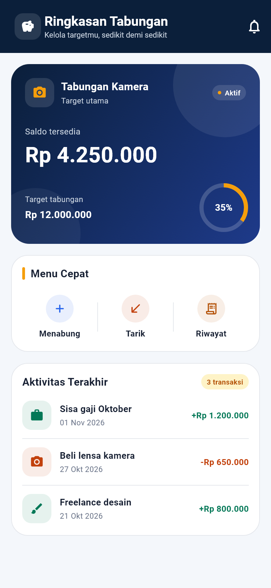
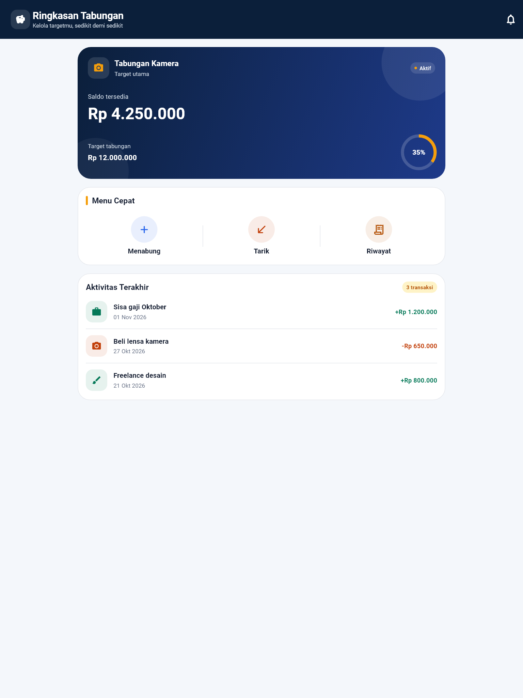

# TabungKu Layout

Tugas Minggu 3 mata kuliah Pemrograman Mobile: menyusun layout aplikasi
TabungKu menggunakan widget dasar Flutter.

## Identitas

| Keterangan | Isi |
| --- | --- |
| Nama | Zefhana Ananda |
| NIM | 20240801047 |
| Mata Kuliah | Pemrograman Mobile |
| Tugas | Tugas Minggu 3 - Menyusun Layout dengan Widget Dasar Flutter |

## Deskripsi

Halaman `RingkasanPage` menampilkan kondisi tabungan "Tabungan Kamera":
saldo `Rp 4.250.000`, target `Rp 12.000.000`, dan progres 35%. Selain itu
terdapat tiga aksi cepat serta tiga transaksi terakhir. Semua data masih
statis dan tidak menggunakan package pihak ketiga atau GetX.

Susunan visual:

- AppBar navy dengan judul "Ringkasan Tabungan".
- Kartu ringkasan bergradasi navy dengan cincin progres.
- Satu panel berisi tiga tombol aksi: Menabung, Tarik, dan Riwayat.
- Satu panel riwayat berisi tiga baris transaksi dan pembatas.

Widget dasar yang dipakai:

- `Scaffold`, `AppBar`, `SafeArea`, dan `SingleChildScrollView`.
- `Card`, `Container`, `Column`, `Row`, `Padding`, `SizedBox`, `Divider`.
- `Expanded`, `Alignment`, `mainAxisAlignment`, dan `crossAxisAlignment`.
- `LayoutBuilder`, `Center`, dan `ConstrainedBox` untuk responsivitas.
- `CircularProgressIndicator` untuk cincin progres target.

## Screenshot

| Ponsel (390 x 844) | Tablet (1024 x 1366) |
| --- | --- |
|  |  |

Pada ponsel, kartu ringkasan, panel aksi, dan panel transaksi disusun
vertikal mengikuti lebar layar. Pada tablet, susunan tetap satu kolom
vertikal dengan lebar konten maksimum 720 px dan diposisikan di tengah
agar tetap proporsional tanpa terbagi menjadi kolom-kolom kecil.

## Cara Menjalankan

Dari root repository:

```bash
cd lib/tabungku_layout
flutter pub get
flutter run
```

Untuk membuat ulang screenshot dokumentasi:

```bash
flutter test
```

Perintah tersebut menghasilkan `docs/01-hp.png` dan `docs/02-tablet.png`.

## Struktur Project

```text
lib/tabungku_layout/
├── lib/
│   └── main.dart
├── docs/
│   ├── 01-hp.png
│   └── 02-tablet.png
├── test/
│   └── widget_test.dart
├── android/
├── web/
├── pubspec.yaml
└── README.md
```

Project ini berada di dalam folder `lib` repository PEMMOB. Karena itu,
perintah Flutter di atas harus dijalankan dari folder `lib/tabungku_layout`,
bukan dari root repository.
